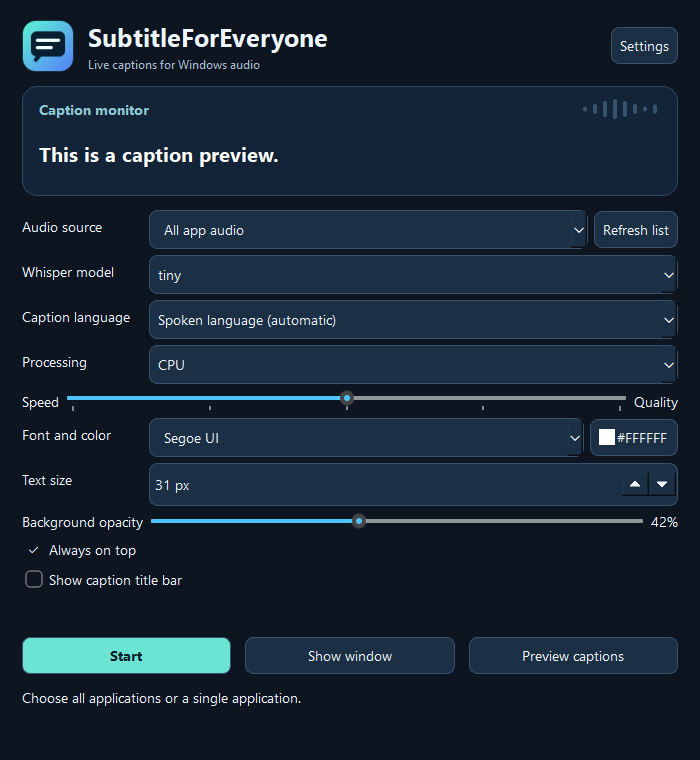
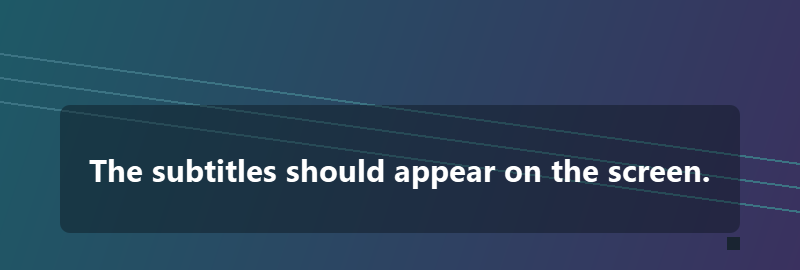
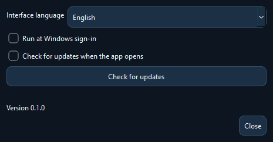

# SubtitleForEveryone

SubtitleForEveryone generates live captions for Windows audio. It is designed for deaf and hard-of-hearing people who want captions for videos, calls, and other desktop apps. Captions can stay visible in a movable, transparent window above the app you are using.

[Download for Windows 11 x64](https://github.com/tonythewizard/SubtitleForEveryone/releases) · [License](LICENSE)



## Install and start

1. Open [GitHub Releases](https://github.com/tonythewizard/SubtitleForEveryone/releases) and download `SubtitleForEveryone-Setup-<version>-x64.exe`. The release includes a SHA‑256 checksum. The current setup is unsigned.
2. Run the installer. It installs for the current Windows user and creates a Start menu shortcut. A desktop shortcut is optional. The installer includes the desktop runtime, native Windows audio capture, and the CPU and Vulkan engines.
3. Select **All app audio**, keep **CPU** and **tiny** for an initial test, and select **Start**. Play a video or other speech in a Windows app. The first run needs an internet connection to download the selected model.
4. Use **Preview captions** to test positioning and appearance. Drag the text area to move the floating window, and use its lower-right corner to resize it.

The app requires **Windows 11 x64**. The installer includes its Python and Visual C++ runtimes. It also includes the Vulkan backend, which uses the installed graphics driver.

## Features

| Feature | How it works |
| --- | --- |
| **All app audio** | Captures playback across Windows applications, including apps routed to different audio outputs. To focus on one app, select its process or enter a name such as `chrome.exe`. A browser process can include more than one tab. |
| **Caption monitor** | Shows the latest caption and incoming audio level. **Preview captions** displays sample text without starting capture. |
| **Floating captions** | Choose the font, text color, size, and background opacity. Turn on **Always on top** to keep captions visible above other windows. The title bar is hidden by default and can be shown from the main panel. |
| **Original speech and translation** | **Spoken language (automatic)** captions the detected language. You can instead translate to English, Italian, Spanish, French, or German. Translation runs locally through Argos Translate. Supported language pairs download on first use. |
| **Speed ↔ Quality** | Pause transcription to adjust the slider. Towards **Speed**, previews appear sooner. Towards **Quality**, the app waits for longer context, queues finished captions in order, and splits long text to fit the floating window. |
| **System tray** | Closing the main panel sends it to the tray. From the tray you can reopen it, start or pause transcription, toggle the floating window, or exit. |



## Models and acceleration

| Processing | Inference engine | Requirements |
| --- | --- | --- |
| **CPU** | faster-whisper / CTranslate2, INT8 | Baseline for Windows 11 x64 PCs. |
| **CUDA** | faster-whisper / CTranslate2 | Compatible NVIDIA GPU and driver. The installed app downloads about 1.3 GB of NVIDIA runtimes on first use. |
| **Vulkan** | whisper.cpp with GGML models | Compatible Vulkan GPU and graphics driver. The installer includes the server and GPU detection tool. |

Choose Whisper `tiny`, `base`, `small`, `medium`, or `large-v3`. Larger models need more time and memory. The status line shows the active backend, and the app can fall back to CPU if a GPU backend fails.

Whisper model files are verified against the checksums of pinned upstream revisions. Valid copies are reused offline, and missing or damaged files are downloaded when needed. The cache lives at `%LOCALAPPDATA%\SubtitleForEveryone\models`. Speech recognition and translation process audio and text on the PC.

## Settings and updates

- **Interface language** follows Windows by default. You can select English, Italian, Spanish, French, or German. The app restarts after a language change and resumes active transcription.
- **Run at Windows sign-in** opens the app when the current user signs in.
- **Check for updates** checks this repository’s latest stable GitHub release. Enable the checkbox to check on launch. After you confirm an update, the installed app downloads the setup, checks its size and SHA‑256 digest against GitHub release metadata, and launches it. Source builds open the release page. The unauthenticated check requires a public release.



## Troubleshooting

- **Captions cover the video controls.** Drag the window by the text area or adjust its size, opacity, or position. If an exclusive fullscreen player covers the caption window, switch the player to borderless window mode.
- **Captions lag or skip speech.** Try a smaller Whisper model or move the slider towards **Speed**. Towards **Quality**, the app waits for more context. If processing falls too far behind, the queue can reach its limit.
- **A GPU is unavailable.** Check the graphics driver and the status line. **CPU** is available as a fallback.
- **No public release is available.** The update checker shows this message when it cannot access a public stable release.

## Build from source

Install Python 3.12 x64 with the `py` launcher, Visual Studio Build Tools with **Desktop development with C++**, and the Windows SDK. Run:

```powershell
.\setup_windows.ps1
.\run_windows.bat
```

For CUDA from source, run `.\setup_cuda.ps1`. For Vulkan, prepare the server with `.\setup_vulkan.ps1 -Model tiny -GpuIndex 1`, using the correct GPU index. Building the server requires CMake, Ninja, and the Vulkan SDK. The packaged backend uses [whisper.cpp v1.8.3](https://github.com/ggml-org/whisper.cpp/tree/v1.8.3).

To build the standalone setup, install [the build requirements](requirements-build.txt) in `.venv`, install Inno Setup 6, and set `VULKAN_SDK` to the SDK directory. Run `.\build_windows.ps1` and then `.\build_installer.ps1`. The setup is written to `installer\`.

The [Windows installer workflow](.github/workflows/windows-installer.yml) builds an artifact on demand. A version tag matching [VERSION](VERSION) builds and smoke-tests the setup, then publishes it with its checksum and dependency inventory.

## License

SubtitleForEveryone is licensed under the **GNU General Public License v3.0 only (GPL‑3.0-only)**. See [LICENSE](LICENSE) for the full text. It is derived from [SubtitleForStream](https://github.com/tonythewizard/SubtitleForStream). Third-party components retain their own licenses. The installed build includes their notices under `_internal\licenses`.
